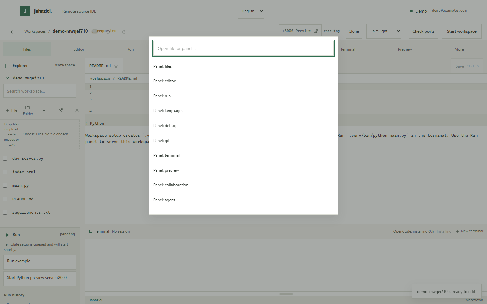
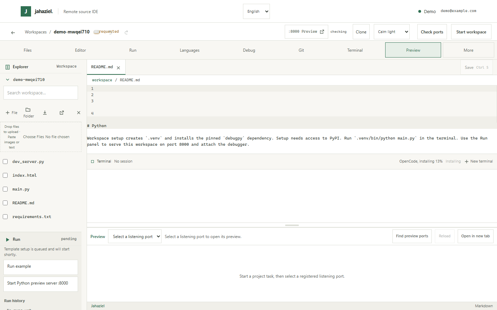
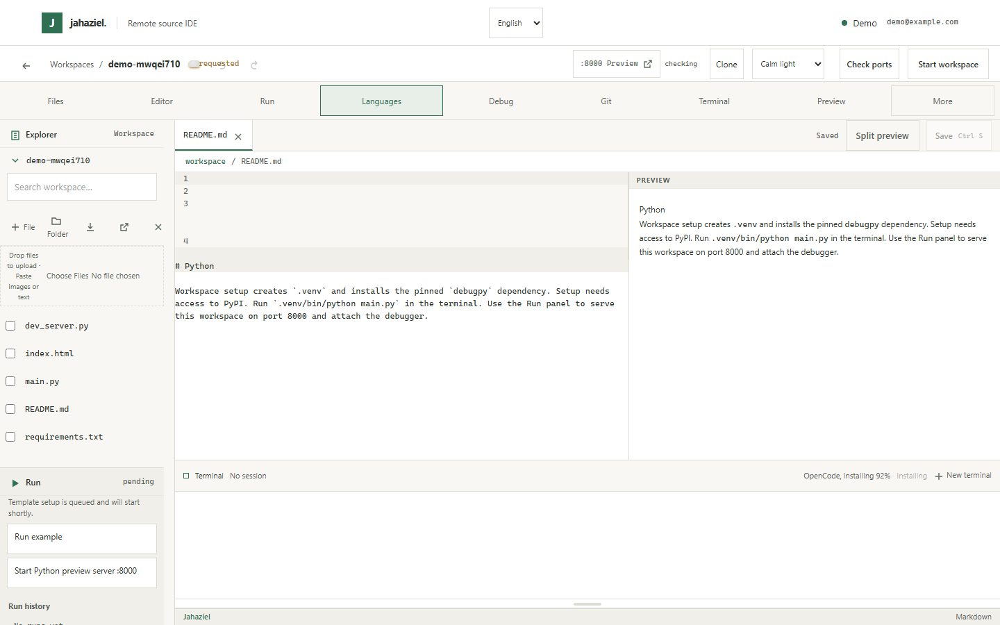
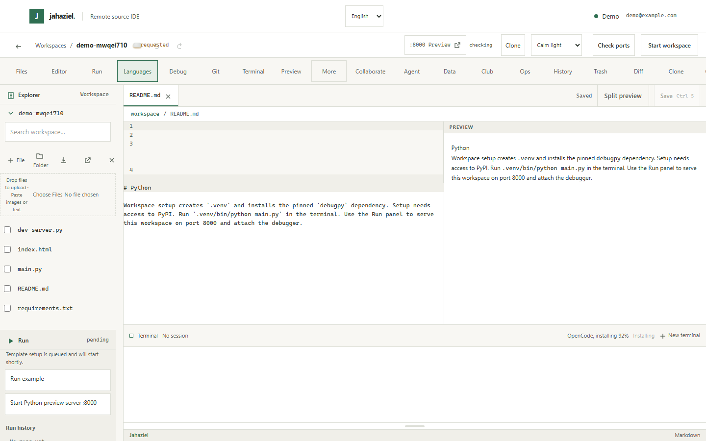
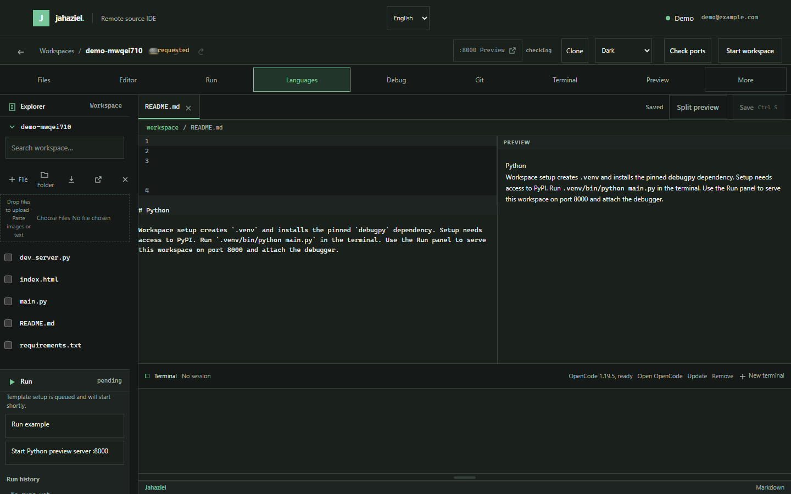
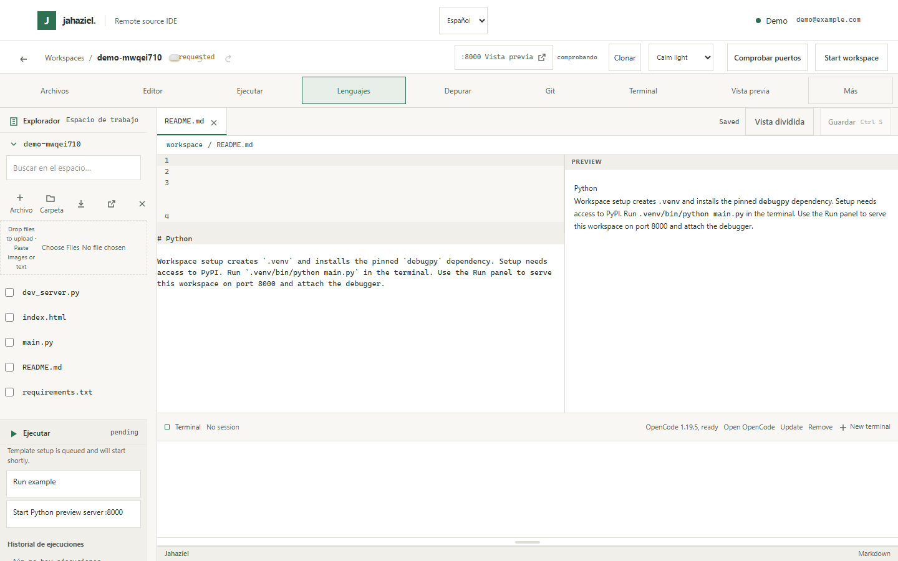

<!--

    Copyright 2026 The Jahaziel Authors
    SPDX-License-Identifier: Apache-2.0

-->

# Jahaziel — Self-Hosted Browser IDE for iPad and Remote Linux Workspaces

**Jahaziel is an iPad-first, self-hosted browser IDE for source code stored on your own server.** One Java application serves a persistent workbench with a file explorer, code editor, real terminal, tasks, previews, Git, debugging, and optional language diagnostics. Connect from iPad Safari, Chrome, or Edge, or from any modern desktop browser — no local IDE or SSH is needed for normal editing.

> [!WARNING]
> Jahaziel runs workspace terminals, tasks, and Git operations as native host processes under the same service account. Use it with **trusted users only**. It does not provide operating-system isolation between workspaces or hostile multi-tenant security.

## Watch the demo

The walkthrough below was recorded headlessly against the packaged jar in demo mode. It shows workspace creation, the editor and quick-open palette, every service panel, grouped navigation, the dark theme, locale switching, and the iPad layout.

[Download the demo video (WebM)](docs/assets/demo/demo-walkthrough.webm)

### Screenshots

| Workspace home | Workbench and file explorer |
|---|---|
|  |  |

| Code editor | Quick-open palette |
|---|---|
|  |  |

| Run and tasks | Terminal |
|---|---|
|  |  |

| Preview | Git |
|---|---|
|  |  |

| Debugger | Language diagnostics |
|---|---|
|  |  |

| Grouped panels | Dark theme |
|---|---|
|  |  |

| Localized UI | iPad layout |
|---|---|
|  |  |

## Why Jahaziel

- **Edit server-side source in the browser.** Browse workspace files, edit with CodeMirror 6, and detect conflicting saves using ETags.
- **Use a real host shell.** Open an authenticated xterm.js terminal in the workspace directory; sessions persist and reconnect after a reload.
- **Run and preview projects.** Discover tasks, run them with bounded output, register preview ports, and open workspace-scoped preview links.
- **Work from iPad.** Touch-sized controls, a terminal shortcut strip, Split View, Stage Manager, and keyboard/trackpad support.
- **Start from a real template.** Node.js, Python, Java, C/C++, Go, Rust, static-site, or empty starters create starter files and server-owned setup steps.
- **Use a coding agent.** OpenCode is installed once into the user's private data area and launched from an authenticated terminal. Provider sign-in stays in the OpenCode TUI.
- **Add diagnostics on demand.** Select pinned language packs explicitly; nothing is fetched at startup.
- **Keep Git close to the editor.** Review status and diffs, stage or unstage changes, and commit from the Git panel.
- **Operate one jar.** SQLite state, keys, logs, and workspace files live under a jar-adjacent data directory. Linux, macOS, and Windows are supported with one executable and one application port.

## What runs where

| Component | Supported target |
|---|---|
| Jahaziel server | Linux x86_64 and arm64, macOS, and Windows; Linux x64 and arm64 are CI-verified |
| Primary browser clients | iPad Safari, Chrome, and Edge; touch-only and keyboard/trackpad workflows |
| Desktop browser clients | Modern browsers on Windows, macOS, and Linux |
| Workbench | SolidJS, DaisyUI, CodeMirror 6, and xterm.js, served from the jar |
| Workspace execution | Native host processes under the service account, adapted per OS |
| Supervisors | systemd (Linux), launchd (macOS), or a WinSW Windows service |

The jar does not bundle a VS Code server or project runtimes. Install only the host runtimes your projects need. Workspace processes, previews, and terminal tools share the service account, so this release is for mutually trusted teams.

## Deploy Jahaziel

All three paths use the **same single executable jar** and **one application port** (default `11451`).

### Path 1 — Packaged jar upload

~~~bash
./mvnw -B verify -Psmoke
scp target/jahaziel.jar jahaziel@example-host:/var/lib/jahaziel/jahaziel.jar
~~~

On the host:

~~~bash
java -jar jahaziel.jar init
java -jar jahaziel.jar doctor
java -jar jahaziel.jar
~~~

`capabilities` lists available tools; health is at `http://127.0.0.1:11451/actuator/health`. Real environment variables override `.env`, and configuration is read at startup. See [single-server deployment](docs/deployment/single-server.md#path-1--packaged-jar-upload).

### Path 2 — OS supervisor

Register the jar with the host's supervisor: `ops/services/jahaziel.service` (Linux), `ops/launchd/` (macOS), or `ops/windows/` (WinSW). Use `ops/caddy/` for HTTPS and workspace previews. See [service templates per OS](docs/deployment/single-server.md#service-templates-per-os).

### Path 3 — Clone the repository on the target

For air-gapped hosts, source audits, or local patches. Prerequisites: JDK 25, Node 24+, and pnpm 12.14.0.

~~~bash
git clone https://github.com/richie-rich90454/jahaziel.git
cd jahaziel
pnpm --dir web install --frozen-lockfile && pnpm --dir web build
./mvnw -B package -DskipTests -Dmaven.test.skip=true
~~~

Then run `init`, `doctor`, and register the supervisor as above.

### Local demo (development only)

~~~bash
java -jar jahaziel.jar init
java -jar jahaziel.jar --demo
~~~

Demo mode stubs the identity provider, seeds a sample user and workspace, and binds only to loopback. Never expose it to a network or use it with real data.

## Authentication and sign-in

Login is provider-neutral. The plugin kernel discovers auth plugins, and the first enabled, configured provider wins:

| Priority | Provider | Plugin name |
|---|---|---|
| 1 | Basis / DevConnect OIDC | `basis-auth` |
| 2 | Microsoft Entra ID, Google, GitHub | `microsoft`, `google`, `github` |
| 3 | Generic OIDC | `oidc` |
| 4 | Local password with TOTP | `local` |
| 5 | Passkey (WebAuthn) | `passkey` |
| 6 | API token, LDAP | `api-token`, `ldap` |

The lean canonical basis-auth keys are `BASIS_AUTH_ISSUER`, `BASIS_AUTH_CLIENT_ID`, `BASIS_AUTH_CLIENT_SECRET`, `BASIS_AUTH_RESOURCE`, `BASIS_AUTH_RESOURCE_SECRET`, `BASIS_AUTH_INTERNAL_URL`, `BASIS_AUTH_COOKIE_SECRET` (at least 32 bytes), and `CURRENT_URL_ORIGIN`. Callbacks derive from the origin: `${CURRENT_URL_ORIGIN}/api/auth/basis/callback` and `${CURRENT_URL_ORIGIN}/api/auth/basis/backchannel`. Legacy `BASIS_*` names are aliases only. See the [basis-auth downstream contract](docs/basis_auth_setup_guide.md) for the full production checklist.

## Operations

~~~bash
java -jar jahaziel.jar doctor              # preflight checks
java -jar jahaziel.jar capabilities        # tool capabilities
java -jar jahaziel.jar backup              # back up .env and data/
java -jar jahaziel.jar restore <file>      # restore a verified backup
java -jar jahaziel.jar support-bundle      # redacted diagnostics
java -jar jahaziel.jar update --status     # staged update state
java -jar jahaziel.jar logs --follow       # application logs
~~~

Updates are staged and verified with SHA-256 before the next start; rollback is supported. See [backup and restore](docs/operations/backup.md) and [update and rollback](docs/deployment/single-server.md#updating-and-rollback).

## Security and trust boundary

Jahaziel authenticates every workspace API, enforces path and symlink containment, uses ETags for safe saves, binds OIDC state to a short-lived cookie, validates discovered issuers, and redacts secrets from logs. It does **not** offer VM isolation, hostile multi-tenancy, or a tamper-proof compliance audit chain. Read the [threat model](docs/security/threat-model.md) before deploying.

## Project status

Jahaziel is under active development at version `0.1.0-SNAPSHOT`; CI artifacts are build outputs for evaluation, not stable release packages. Linux x64 and arm64 CI is green, a 62-test Playwright suite covers the workbench, and a 19-check deployment walkthrough passes on five host targets. Those are regression checks, not host acceptance: a release still requires physical iPad browser testing and live-host checks with a real identity provider, DNS, TLS, and MFA. See [release acceptance](docs/operations/release-acceptance.md) and the [current plan](docs/plan.md).

## Frequently asked questions

**Is Jahaziel a VS Code fork?**
No. The shipped product is a single Java jar with a SolidJS workbench using CodeMirror 6 and xterm.js.

**Can I use it for untrusted users?**
No. Workspace processes share one service account. It is designed for mutually trusted teams.

**Which database does it use?**
SQLite by default, stored under the jar-adjacent data directory. No PostgreSQL setup is required.

**Does it need an identity provider?**
For production sign-in, yes: configure a compatible OIDC provider. The loopback demo mode uses a stub IdP and is development-only.

**Can it run on macOS or Windows servers?**
The same jar runs on both; service templates exist. Real-host acceptance for those platforms is still open.

**How do I regenerate the demo screenshots and video?**
Run `node tools/demo-capture.cjs target/jahaziel.jar` after building the jar. It uses the bundled Playwright browser headlessly on loopback and does not touch your browser profile.

## Documentation

- [Deploy on a single server](docs/deployment/single-server.md)
- [Platforms and supervisors](docs/guide/platforms.md)
- [Quick start](docs/guide/quick-start.md) and [using the workbench](docs/guide/using-jahaziel.md)
- [Configuration](docs/guide/configuration.md) and [environment variables](docs/reference/env-vars.md)
- [Architecture](docs/architecture/overview.md) and [browser workbench](docs/architecture/ide.md)
- [Security and trust boundary](docs/security/threat-model.md)
- [CLI reference](docs/reference/cli.md) and [current plan](docs/plan.md)

## Contribute and get help

Bug reports and feature proposals are welcome. Include the server architecture, Java version, reproduction steps, and redacted logs. Never attach `.env`, private keys, workspace source, or unredacted support bundles.

- [Report a bug](https://github.com/richie-rich90454/jahaziel/issues/new?template=bug_report.md)
- [Request a feature](https://github.com/richie-rich90454/jahaziel/issues/new?template=feature_request.md)
- [Contribution guide](CONTRIBUTING.md)

If Jahaziel fits your workflow, star the repository and tell us what you use it for.

## License

Apache License 2.0. See [LICENSE](LICENSE).
