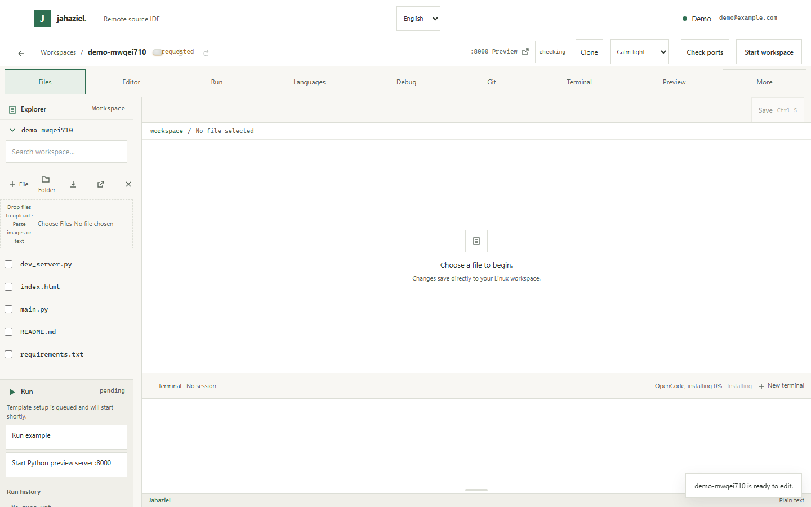
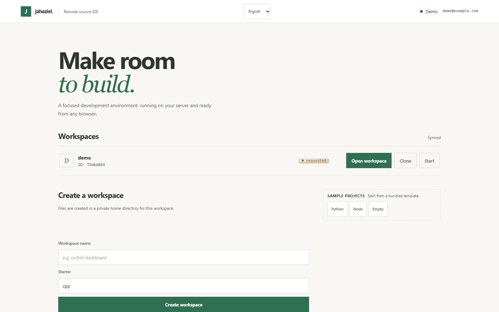
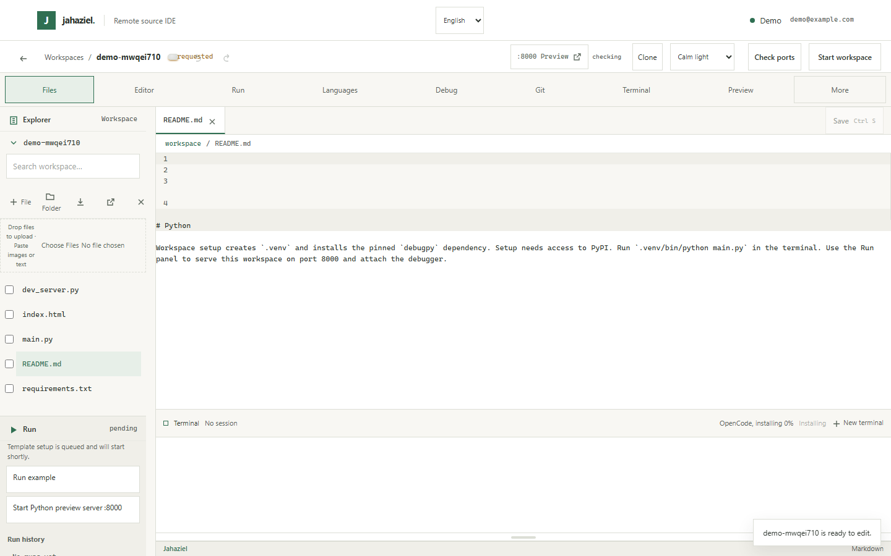
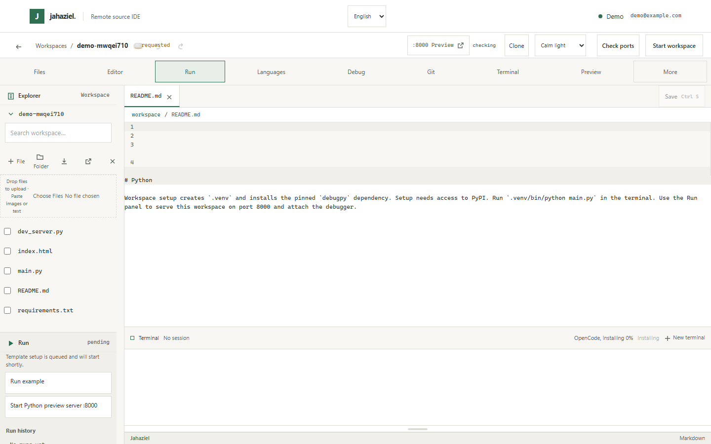
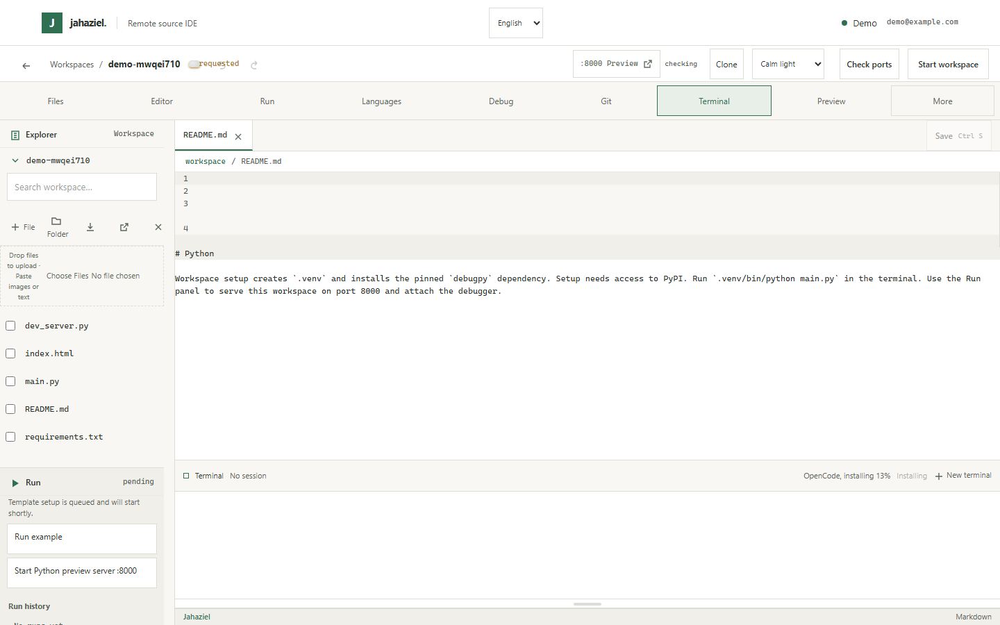
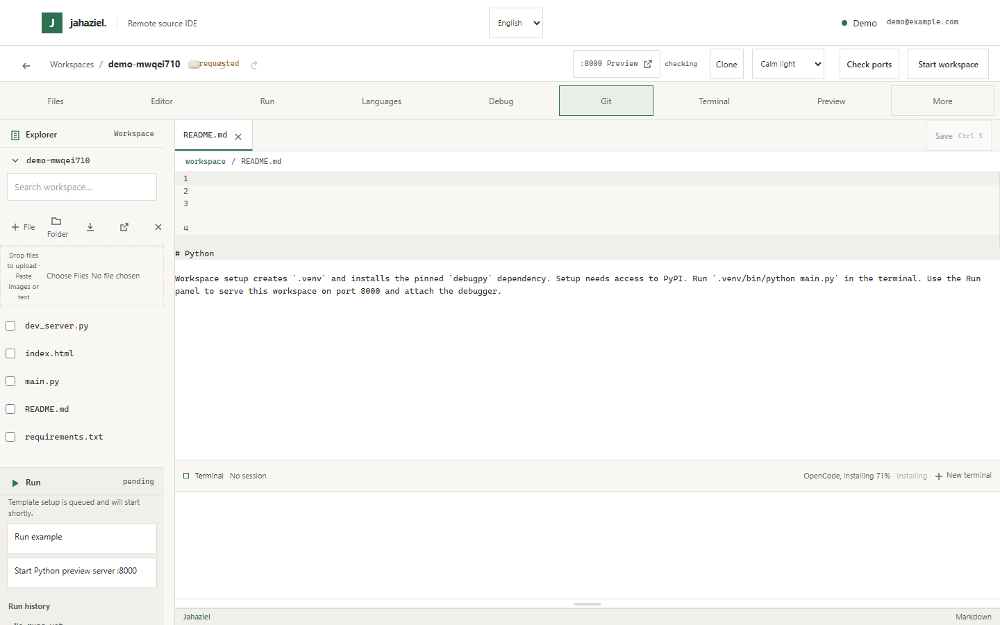
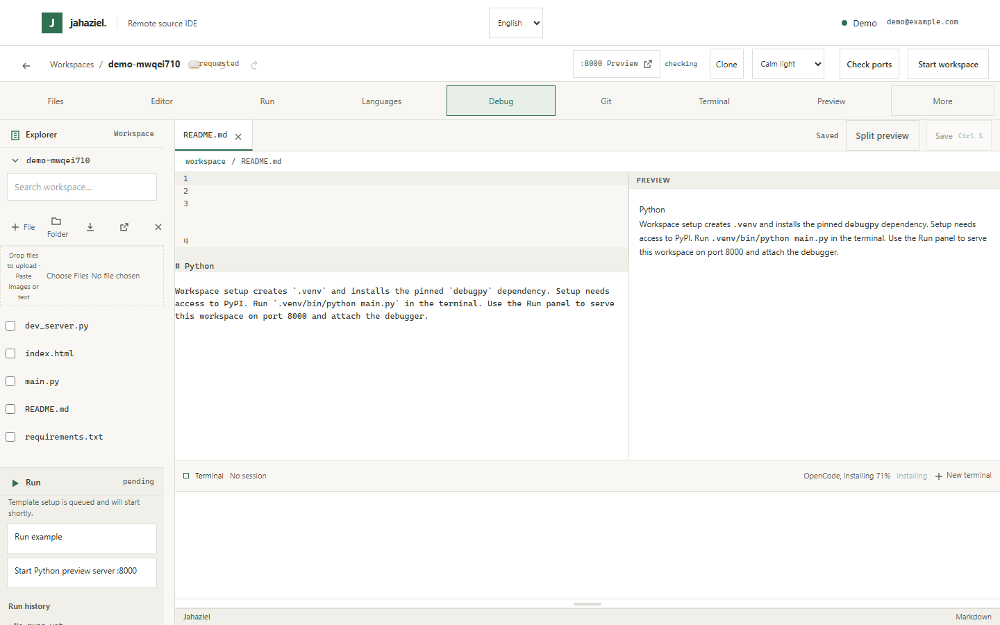
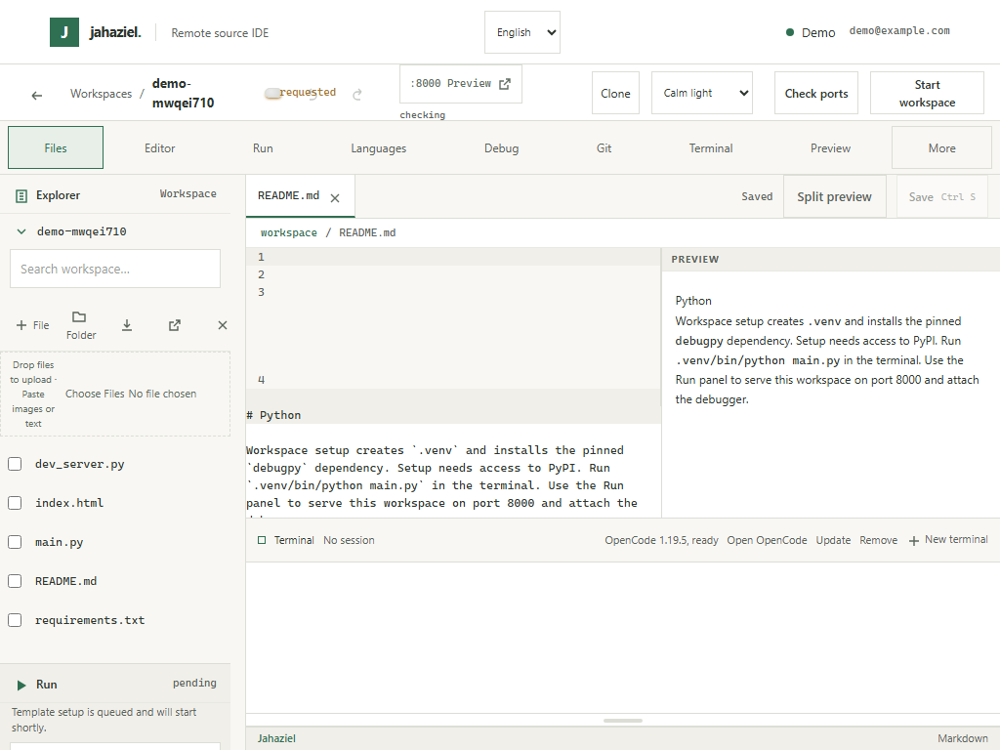

<!--

    Copyright 2026 The Jahaziel Authors
    SPDX-License-Identifier: Apache-2.0

-->

# Jahaziel — The iPad-First, Self-Hosted Browser IDE

**Jahaziel is a self-hosted browser IDE built for iPad first.** Edit code on your own server from Safari, Chrome, Edge, or any desktop browser — with a persistent file explorer, CodeMirror editor, real terminal, tasks, previews, Git, debugging, and optional language diagnostics. It ships as one Java jar with SQLite, so a personal remote development environment is a single download, not a cluster.

> [!WARNING]
> Workspace terminals, tasks, and Git operations run as native host processes under the same service account. Use Jahaziel with **trusted users only**. It does not provide operating-system isolation or hostile multi-tenant security.

## Quick links

[Watch the demo](#watch-the-demo) · [Why Jahaziel](#why-jahaziel) · [Try it in 60 seconds](#try-it-in-60-seconds) · [Features](#features-at-a-glance) · [Deploy](#deploy-jahaziel) · [Authentication](#authentication-and-sign-in) · [FAQ](#frequently-asked-questions) · [Contribute](#contribute)

## Watch the demo

A headless walkthrough of the packaged jar: workspace creation, editor and quick-open, every service panel, grouped navigation, dark theme, locale switching, and the iPad layout.

[Download the demo video (WebM)](docs/assets/demo/demo-walkthrough.webm)

| Workspace home | Workbench and file explorer |
|---|---|
|  |  |

| Code editor | Quick-open palette |
|---|---|
|  |  |

| Run and tasks | Terminal |
|---|---|
|  |  |

| Preview | Git |
|---|---|
|  |  |

| Debugger | Language diagnostics |
|---|---|
|  |  |

| Grouped panels | Dark theme |
|---|---|
|  |  |

| Localized UI | iPad layout |
|---|---|
|  |  |

## Why Jahaziel

- **Built for the iPad.** Touch-sized controls, a terminal key strip, Split View and Stage Manager support, and a keyboard/trackpad path for desktop workflows.
- **Your code stays on your server.** Workspaces are persistent directories with ETags, conflict recovery, and local drafts — no vendor account required for editing.
- **A real development environment.** Browse files, edit with CodeMirror 6, open an authenticated xterm.js terminal, discover and run tasks, register preview ports, inspect Git diffs, debug with DAP, and add language packs on demand.
- **One jar, one port.** Java 25, SQLite, jar-adjacent data, and host-supervisor templates for Linux, macOS, and Windows. No database server or message broker to operate.
- **Provider-neutral sign-in.** Basis/DevConnect OIDC, Microsoft, Google, GitHub, generic OIDC, local password with TOTP, passkeys, API tokens, and LDAP — with a documented production checklist.
- **Agent-friendly workspace.** OpenCode is installed per user and launched from the terminal; language diagnostics use pinned packs that are fetched only after explicit selection.

## Who it's for

| Scenario | Why it fits |
|---|---|
| **iPad-only development** | A real editor, shell, and preview loop without carrying a laptop. |
| **Homelab and self-hosting** | One jar, SQLite, and a data directory you control; no SaaS dependency for editing. |
| **Small trusted teams** | Shared host, private workspace homes, provider-based identities, and an audit trail. |
| ** Teaching and workshops** | Template-backed workspaces, run tasks, previews, and an optional Club panel. |
| ** Remote access to a build host** | Browser terminal and tasks against the machine where your toolchains already live. |

## Features at a glance

| Area | What you get |
|---|---|
| Files | Tree, create/rename/delete, upload, search, ETag conflict resolution, drafts |
| Editor | CodeMirror 6 tabs, Markdown preview, diagnostics, breakpoints, save state |
| Run | Template tasks, task output, run history, preview port registration |
| Terminal | Persistent PTY sessions, reconnect, copy, touch key strip |
| Git | Status, diff, stage/unstage, commit |
| Debug | Launch/attach, breakpoints, stack, variables, watches, console |
| Languages | Explicit pinned packs for Python, TypeScript, Java, C/C++, Go, Rust |
| Services | Collaboration, agent assistant, data tools, Club, admin operations |
| Accessibility & i18n | 44px touch targets, high-contrast theme, English/Spanish/French/German/Japanese |

## Try it in 60 seconds

Requires JDK 25. The loopback demo seeds a user and workspace and ignores real credentials.

~~~bash
git clone https://github.com/richie-rich90454/jahaziel.git
cd jahaziel
./mvnw -B package -DskipTests -Dmaven.test.skip=true
cd target && java -jar jahaziel.jar init && java -jar jahaziel.jar --demo
~~~

Open `http://127.0.0.1:11451`. Never expose demo mode to a network.

## How it compares

| | Jahaziel | Typical self-hosted web IDE | Public cloud IDE |
|---|---|---|---|
| Server footprint | One jar + SQLite | Node runtime + packages + separate DB | Vendor-managed |
| Browser clients | iPad Safari first, plus Chrome/Edge/desktop | Desktop-oriented | Varies |
| Workspace storage | Your jar-adjacent data directory | Your server | Vendor storage |
| Terminal model | Native host process, trusted users | Container or host process | Vendor sandbox |
| Offline package fetching | No startup downloads; explicit pinned packs | Varies | Managed by vendor |

Jahaziel is deliberately scoped: it is a trusted-user workbench, not a hostile multi-tenant platform or a VS Code fork.

## Deploy Jahaziel

All three paths use the same executable jar and one application port (default `11451`).

### Path 1 — Packaged jar upload

~~~bash
./mvnw -B verify -Psmoke
scp target/jahaziel.jar jahaziel@example-host:/var/lib/jahaziel/jahaziel.jar
~~~

On the host: `java -jar jahaziel.jar init`, then `doctor`, then run. Health is at `http://127.0.0.1:11451/actuator/health`. See [single-server deployment](docs/deployment/single-server.md#path-1--packaged-jar-upload).

### Path 2 — OS supervisor

Use `ops/services/jahaziel.service` (Linux), `ops/launchd/` (macOS), or `ops/windows/` (WinSW). Add HTTPS and previews with `ops/caddy/`. See [service templates](docs/deployment/single-server.md#service-templates-per-os).

### Path 3 — Clone on the target

For air-gapped hosts and source audits. Prerequisites: JDK 25, Node 24+, pnpm 12.14.0.

~~~bash
git clone https://github.com/richie-rich90454/jahaziel.git
cd jahaziel
pnpm --dir web install --frozen-lockfile && pnpm --dir web build
./mvnw -B package -DskipTests -Dmaven.test.skip=true
~~~

## Authentication and sign-in

The first enabled, configured plugin wins:

| Priority | Provider | Plugin name |
|---|---|---|
| 1 | Basis / DevConnect OIDC | `basis-auth` |
| 2 | Microsoft Entra ID, Google, GitHub | `microsoft`, `google`, `github` |
| 3 | Generic OIDC | `oidc` |
| 4 | Local password with TOTP | `local` |
| 5 | Passkey (WebAuthn) | `passkey` |
| 6 | API token, LDAP | `api-token`, `ldap` |

Canonical basis-auth keys: `BASIS_AUTH_ISSUER`, `BASIS_AUTH_CLIENT_ID`, `BASIS_AUTH_CLIENT_SECRET`, `BASIS_AUTH_RESOURCE`, `BASIS_AUTH_RESOURCE_SECRET`, `BASIS_AUTH_INTERNAL_URL`, `BASIS_AUTH_COOKIE_SECRET` (32+ bytes), `CURRENT_URL_ORIGIN`. Callbacks derive from that origin; legacy `BASIS_*` names are aliases only. See the [downstream contract](docs/basis_auth_setup_guide.md).

## Operations

~~~bash
java -jar jahaziel.jar doctor              # preflight checks
java -jar jahaziel.jar capabilities        # tool capabilities
java -jar jahaziel.jar backup              # back up .env and data/
java -jar jahaziel.jar restore <file>      # restore a verified backup
java -jar jahaziel.jar support-bundle      # redacted diagnostics
java -jar jahaziel.jar update --status     # staged update state
java -jar jahaziel.jar logs --follow       # application logs
~~~

Updates are SHA-256 verified and staged for the next start; rollback is supported. See [backup and restore](docs/operations/backup.md).

## Security and trust boundary

Workspace APIs are authenticated, paths and symlinks are contained, saves use ETags, OIDC state is bound to a short-lived cookie, discovered issuers are validated, and secrets are redacted from logs. The product does **not** claim VM isolation, hostile multi-tenancy, or a tamper-proof compliance chain. Read the [threat model](docs/security/threat-model.md) first.

## Project status

Active development at `0.1.0-SNAPSHOT`; CI artifacts are evaluation builds, not stable release packages. Linux x64/arm64 CI is green, 62 Playwright tests cover the workbench, and a 19-check deployment walkthrough runs on five host targets. Release acceptance still requires physical iPad testing and a live host with a real IdP, DNS, TLS, and MFA. See [release acceptance](docs/operations/release-acceptance.md) and the [roadmap](docs/plan.md).

## Frequently asked questions

**Is Jahaziel a VS Code fork?**
No. It is one Java jar with a SolidJS workbench using CodeMirror 6 and xterm.js.

**Can I use it for untrusted users?**
No. Workspace processes share one service account; it is for mutually trusted teams.

**Which database does it use?**
SQLite by default, under the jar-adjacent data directory. No PostgreSQL is required.

**Does it need an identity provider?**
Production sign-in needs a configured OIDC provider. Loopback demo mode uses a stub IdP and is development-only.

**Can it run on macOS or Windows servers?**
The same jar runs on both and service templates exist; real-host acceptance on those platforms is still open.

**How are the demo assets regenerated?**
Run `node tools/demo-capture.cjs target/jahaziel.jar`. It uses the bundled headless browser on loopback and never touches your browser profile.

## Documentation

- [Single-server deployment](docs/deployment/single-server.md)
- [Platforms and supervisors](docs/guide/platforms.md)
- [Quick start](docs/guide/quick-start.md) and [using the workbench](docs/guide/using-jahaziel.md)
- [Configuration](docs/guide/configuration.md) and [environment variables](docs/reference/env-vars.md)
- [Architecture](docs/architecture/overview.md) and [browser workbench](docs/architecture/ide.md)
- [Threat model](docs/security/threat-model.md) and [basis-auth contract](docs/basis_auth_setup_guide.md)
- [CLI reference](docs/reference/cli.md) and [roadmap](docs/plan.md)

## Contribute

Contributions are welcome, and [good first issues](https://github.com/richie-rich90454/jahaziel/issues?q=is%3Aissue+is%3Aopen+label%3A%22good+first+issue%22) are a good place to start.

- [Report a bug](https://github.com/richie-rich90454/jahaziel/issues/new?template=bug_report.md)
- [Request a feature](https://github.com/richie-rich90454/jahaziel/issues/new?template=feature_request.md)
- [Contribution guide](CONTRIBUTING.md)

Include the server architecture, Java version, reproduction steps, and redacted logs. Never attach `.env`, private keys, workspace source, or unredacted support bundles. If Jahaziel saves you a setup session, a star helps other iPad and self-hosting developers find it.

## License

Apache License 2.0. See [LICENSE](LICENSE).
